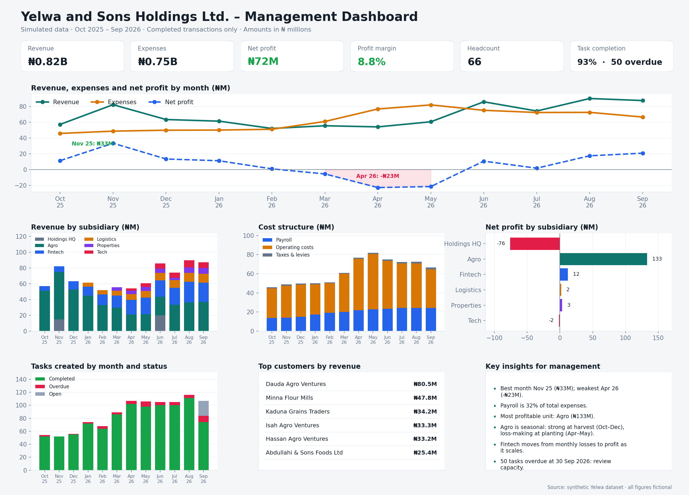

# Yelwa and Sons Holdings Ltd. – Business Analytics Project

A data analysis and dashboard project built on **synthetic (simulated) data** for a fictional 66-employee, multi-subsidiary Nigerian group. Period: Oct 2025 – Sep 2026. Amounts in Nigerian Naira (₦).

## Data model
- `employees` (66) → `workflow_tasks` via `employee_id = assigned_to`
- `customers` (130) → `transactions` via `customer_id = counterparty_id` (revenue rows only)
- `employees` → `transactions` via `employee_id = recorded_by`
- `business_overview_monthly`: pre-aggregated, one row per month per subsidiary

## Cleaning format
1. Trim text fields and parse dates.
2. Check duplicate IDs, month/date consistency, non-positive amounts and orphan keys (all passed).
3. Only `status = Completed` transactions count toward revenue and profit (101 Failed/Reversed/Pending rows excluded).
4. Reconciled recomputed revenue against `business_overview_monthly` (difference = 0).

## Key findings
- Agro earns the most and is seasonal: strong at harvest (Oct–Dec), loss-making at planting (Apr–May).
- Fintech grows from a monthly loss to a profit.
- Logistics, Properties and Tech launch later in the period.
- HQ has no sales revenue; the two grants only partly offset its costs.

## the dashboard data's 
 

## usin Power BI disktop application.
using power bi i  build the relationships above, and recreate the visuals. Samples data relation measures used :
```
Revenue = CALCULATE(SUM(transactions[amount_ngn]), transactions[transaction_type]="Revenue", transactions[status]="Completed")
Expenses = CALCULATE(SUM(transactions[amount_ngn]), transactions[transaction_type]="Expense", transactions[status]="Completed")
Net Profit = [Revenue] - [Expenses]
Profit Margin % = DIVIDE([Net Profit], [Revenue])
Task Completion % = DIVIDE(COUNTROWS(FILTER(workflow_tasks, workflow_tasks[status]="Completed")), COUNTROWS(workflow_tasks))
```
